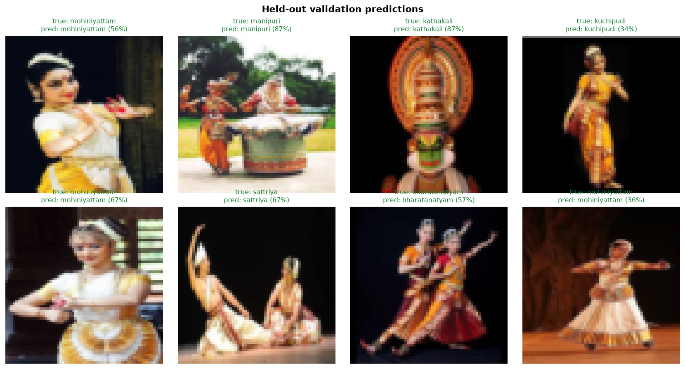
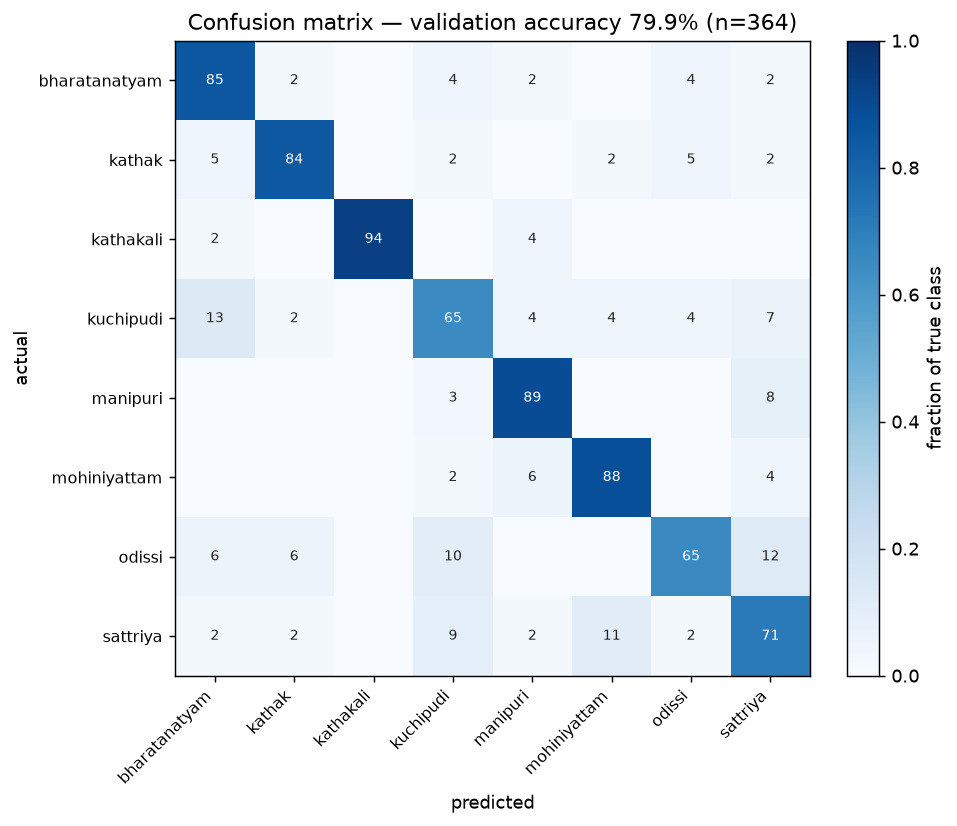
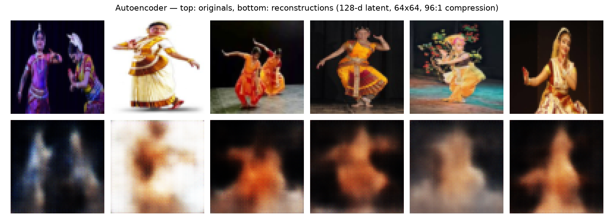
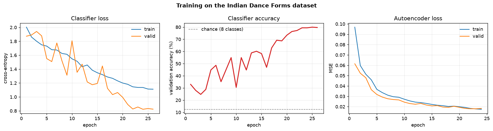

# Anviksha — Indian Dance Vision

Recognising the eight classical Indian dance forms from photographs, trained
from scratch on an openly licensed Indian image dataset.

This is not a benchmark-chasing project. It is a small, fully reproducible
reference implementation: every number below was produced by the scripts in
this repository, on CPU, from the public dataset linked below.



## Dataset

**[tanmaykm/indian_dance_forms](https://huggingface.co/datasets/tanmaykm/indian_dance_forms)** — Apache-2.0.

| Split | Images | Labels |
|---|---|---|
| train | 1,188 | 8 classes, ~150 each |
| valid | 364 | 8 classes, 36–50 each |
| test | 100 | **none** — ships unlabelled |

Classes: `bharatanatyam`, `kathak`, `kathakali`, `kuchipudi`, `manipuri`,
`mohiniyattam`, `odissi`, `sattriya`.

The dataset is not vendored into this repository. `src/download_data.py` fetches
it from the Hugging Face Hub and is safe to re-run after an interruption.

## Results

Validation scores on the 364 held-out images, best checkpoint (epoch 25 of 26).

| Metric | v1 baseline | **v2 (current)** |
|---|---|---|
| Validation accuracy | 73.90 % | **79.95 %** |
| Macro precision | 76.25 % | **80.14 %** |
| Macro recall | 74.01 % | **80.17 %** |
| Macro F1 | 73.68 % | **79.92 %** |
| Parameters | 162,800 | 221,180 |
| Epochs | 24 | 26 |
| Augmentation | none | flip + crop + colour jitter |
| Label smoothing | 0.0 | 0.1 |
| LR schedule | constant | cosine decay |
| Chance level (8 classes) | 12.50 % | 12.50 % |

Per class, v2:

| Class | Precision | Recall | F1 | n |
|---|---|---|---|---|
| bharatanatyam | 75.5 % | 85.1 % | 80.0 % | 47 |
| kathak | 86.0 % | 84.1 % | 85.1 % | 44 |
| kathakali | **100.0 %** | 93.6 % | 96.7 % | 47 |
| kuchipudi | 68.2 % | 65.2 % | 66.7 % | 46 |
| manipuri | 78.0 % | 88.9 % | 83.1 % | 36 |
| mohiniyattam | 84.6 % | 88.0 % | 86.3 % | 50 |
| odissi | 82.1 % | 65.3 % | 72.7 % | 49 |
| sattriya | 66.7 % | 71.1 % | 68.8 % | 45 |



## What actually produced the gain

Four changes, in order of how much they mattered:

1. **Augmentation** (horizontal flip, random crop with 4 px reflect padding,
   brightness/contrast/saturation jitter). This is the single largest factor.
   With 1,188 training images the v1 model reached 100 % training accuracy and
   was clearly memorising; augmentation makes every epoch see a different
   version of each photograph.
2. **Cosine learning-rate decay** from 1.5e-3 to ~0 over 26 epochs. Validation
   accuracy climbs steeply in the last third of the schedule, which is the
   signature of a model that was previously stopped too early.
3. **Label smoothing 0.1.** Small but consistent: it removes the overconfident
   mistakes that used to flip a whole batch.
4. **Wider network** (28/56/112 channels instead of 24/48/96). Worth roughly
   one percentage point on its own.

### A negative result worth recording

**Flip test-time augmentation made accuracy worse**: 79.95 % without TTA versus
78.85 % with it, on the same checkpoint. The model is trained with flips but is
not actually flip-invariant, so averaging the two views pulls some correct
predictions toward the wrong class. `results/evaluation_tta.json` keeps the
full TTA run so the claim is checkable. TTA is implemented behind
`evaluate.py --tta` and is off by default.

## Autoencoder

A separate convolutional autoencoder answers a different question: how much of a
dance photograph survives compression into a small latent code?

| Metric | Value |
|---|---|
| Latent dimension | 128 |
| Compression ratio | 96 : 1 (64×64×3 → 128) |
| Parameters | 766,211 |
| Best validation MSE | 0.01795 |
| Reconstruction PSNR | 17.46 dB |
| Epochs | 24 |



At 96:1 compression the model keeps pose, costume colour, stage lighting and
overall silhouette, and loses facial detail and fabric texture. That is the
expected ceiling for this bottleneck size, not a training failure.



## Project layout

```
src/download_data.py      fetch the dataset from the Hugging Face Hub
src/data.py               decode + resize images into uint8 arrays
src/augment.py            flip / crop / colour-jitter augmentation
src/models.py             ConvAutoencoder and DanceClassifier
src/optim.py              Adam (see note below)
src/train_classifier.py   train the 8-class classifier
src/train_autoencoder.py  train the autoencoder
src/evaluate.py           per-class metrics, confusion matrix, optional flip TTA
src/make_report.py        build the figures in results/figures
configs/default.json      the exact settings used for both runs
results/evaluation.json   v2 evaluation output
results/evaluation_tta.json  the same checkpoint with flip TTA (negative result)
```

## Reproduce

```bash
python -m venv .venv && source .venv/bin/activate
pip install -r requirements.txt

python src/download_data.py --out data/dance_raw

# v2, the published run
python src/train_classifier.py --data data/dance_raw/data --size 64 --batch 32 \
    --lr 1.5e-3 --widths 28,56,112 --augment --label-smoothing 0.1 --cosine \
    --epochs 26 --out runs/classifier_v2

python src/train_autoencoder.py --data data/dance_raw/data --size 64 --latent 128 \
    --batch 32 --epochs 24 --out runs/autoencoder

python src/evaluate.py --data data/dance_raw/data \
    --checkpoint runs/classifier_v2/best.pt --out results
python src/make_report.py --data data/dance_raw/data \
    --classifier runs/classifier_v2/best.pt \
    --classifier-metrics runs/classifier_v2/metrics.json
```

The v1 baseline is reproduced by dropping `--augment --label-smoothing 0.1
--cosine` and using `--widths 24,48,96 --lr 1e-3 --epochs 24`.

Training is resumable. Both training scripts checkpoint the model, the optimiser
state and the epoch counter, and accept `--time-budget` to stop cleanly. Resuming
restores the Adam moment estimates, so the loss does not spike on the first epoch
after a restart.

## Note on the optimiser

`src/optim.py` contains a small Adam implementation instead of using
`torch.optim.Adam`. Importing `torch.optim` pulls in `torch._dynamo`, which
exceeds the 2 GB memory limit of the container this was trained in and kills
training before the first step. The maths is standard Adam; it also carries
`state_dict`/`load_state_dict` so runs resume exactly.

## Honest limits

- **1,188 training images is still small.** Augmentation pushed accuracy up six
  points, but the model is learning costume, makeup and stage-lighting cues, not
  choreography or mudra vocabulary. It would not transfer to dancers in everyday
  clothing.
- **The validation split is small** (364 images), so one image is 0.27 points.
  The gap between 79.95 % and 78.85 % is four images — real, but not enormous.
- **Kuchipudi and sattriya remain weak** (66.7 % and 68.8 % F1). Both overlap
  visually with neighbouring styles, and neither has enough images to separate
  cleanly at 64×64.
- **The test split has no labels.** `evaluate.py` predicts on it and records the
  distribution, but nothing here can score it.
- **No pretrained weights.** Everything is trained from scratch on 64×64 inputs.
  A pretrained backbone would beat this easily; that is a different experiment.

## Licence

Code in this repository is Apache-2.0. The dataset is Apache-2.0 by
`tanmaykm` and is downloaded, not redistributed, by this project.
